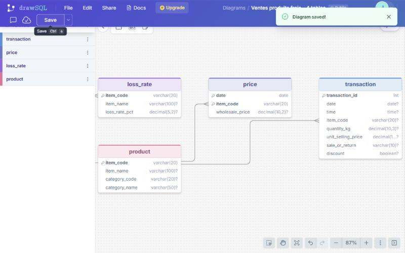
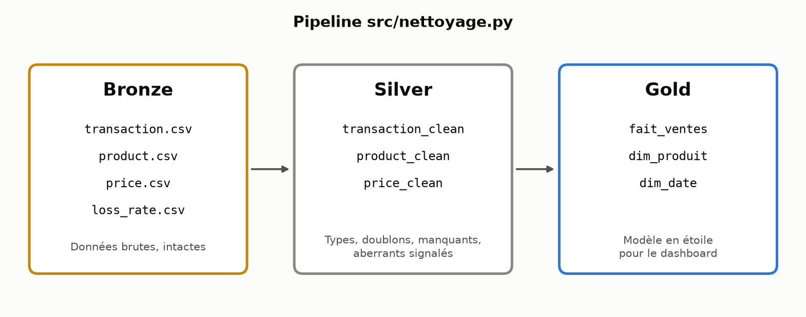

# Ventes de produits frais : nettoyage et consolidation

Exercice 2 du module Data Analytics (Eugenia School, novembre 2026).

**Équipe** : Jahdiel KINVI, Alec DIAMIDIA, [membre 3], [membre 4]
**Outils** : Python (pandas), Git, DrawSQL. Script écrit avec l'aide de Claude Code ; chaque contrôle a été relu et vérifié par l'équipe.

**Objectif** : passer des 4 fichiers bruts à un modèle propre et consolidé, qui alimentera le dashboard du Comex. Le cadrage métier vient de l'exercice 1 : CA, marge brute et volume par catégorie, en N et en N-1.

---

## Lancer le projet

```bash
pip install -r requirements.txt
python src/nettoyage.py
```

Les fichiers bruts vont dans `data/raw/`. Ils ne sont **pas versionnés** dans Git : 50 Mo de données n'ont rien à faire dans un dépôt de code (voir `.gitignore`).

```
data/raw/      Bronze : les 4 CSV d'origine
data/silver/   Silver : tables nettoyées
data/gold/     Gold   : modèle en étoile (fait_ventes, dim_produit, dim_date)
reports/       rapport qualité généré automatiquement
src/           script de transformation
```

---

## Étape 1 : audit des données brutes

Avant de transformer quoi que ce soit, on a contrôlé chaque fichier.

| Fichier | Lignes | Contenu | Problèmes trouvés |
|---|---|---|---|
| transaction.csv | 878 503 | Une ligne par article vendu en caisse (2020-07 à 2023-06) | Date en texte, promo en Yes/No, 1 vente de 160 kg, 12 660 ventes sous le prix d'achat |
| product.csv | 251 | Référentiel articles et catégories | **Espace insécable** caché dans la catégorie « Flower/Leaf Vegetables » (100 articles) |
| price.csv | 55 982 | Prix d'achat de gros par jour et par article | Aucun : clé (date, item_code) unique |
| loss_rate.csv | 251 | Taux de perte par article | item_name en doublon avec product.csv |

Pour les 4 fichiers, on a aussi vérifié :
- **Valeurs manquantes** : aucune.
- **Doublons exacts** : aucun.
- **Item Code** : lu comme un nombre, alors que c'est un identifiant. Il faut le passer en texte.

**Les règles de nettoyage décidées :**

| Problème | Règle | Pourquoi |
|---|---|---|
| Item Code lu comme un nombre | Lu en **texte** dès le chargement | C'est un identifiant : en nombre, il s'affiche en `1,029E+14` et casse les jointures |
| Date en texte | Convertie en date | Pour filtrer par mois et comparer N et N-1 |
| Promo en « Yes » / « No » | Convertie en booléen | Pour les filtres |
| Espace insécable dans les catégories | Remplacé par un espace normal | Sinon un filtre sur « Flower/Leaf Vegetables » ne trouve rien |
| Valeurs manquantes | Contrôlées : 0 | Rien à corriger, mais le contrôle reste dans le script |
| Doublons exacts | Supprimés : 0 | Idem |
| 2 ventes même date + heure + article | **Gardées** | Les quantités diffèrent (0,565 et 0,578 kg) : ce sont deux pesées, pas un doublon |
| Retours | Déjà en quantité négative : cohérence vérifiée | Le CA et le volume sont donc **nets des retours** |
| Quantités au-delà de Q3 + 1,5 × IQR (1,42 kg) | **Signalées**, pas supprimées | La méthode statistique repère 10 570 lignes, dont la plupart sont des achats réels |
| Quantité > 50 kg | Signalée (`flag_qte_extreme`) | 1 vente de 160 kg : probable erreur de saisie, à exclure des analyses |
| Vente sous le prix d'achat | Signalée (`flag_sous_prix_achat`) | Anomalie métier à qualifier : liquidation ou erreur de prix ? |

**Le principe** : on **signale** les valeurs suspectes avec des colonnes `flag_`, on ne les supprime pas. C'est le métier qui décide.

---

## Étape 2 : modélisation

### Les 4 tables sources et leurs relations



- **product** est le référentiel, au centre ; `item_code` est sa clé primaire.
- **transaction**, **price** et **loss_rate** y sont reliées par `item_code`, une clé étrangère.
- **price** a une **clé primaire composée** (date + item_code) : un produit a un prix par jour.
- **Un lien n'apparaît pas sur le schéma** : transaction et price se joignent sur **deux colonnes** (date + item_code), pour récupérer le prix d'achat du jour de la vente. DrawSQL ne trace qu'une colonne par flèche.

### Le modèle cible : un schéma en étoile

```
                 dim_date
        (date, année, mois, période N/N-1)
                     │
dim_produit ──── fait_ventes
(item_code, nom,      (transaction_id, date, item_code,
 catégorie,            quantité, prix_vente, prix_achat,
 taux_perte)           promo, est_retour, ca, marge_brute, flags)
```

| Table | D'où elle vient | Rôle |
|---|---|---|
| **fait_ventes** | transaction + price (jointure date + item_code) | Les mesures, une ligne par article vendu |
| **dim_produit** | product + loss_rate (jointure 1-1) | Le « quoi » : nom, catégorie, taux de perte |
| **dim_date** | Créée à partir des dates de vente | Le « quand » : mois, année, période N / N-1 |

---

## Étape 3 : le code de nettoyage et de consolidation



Le script [`src/nettoyage.py`](src/nettoyage.py) fait tout le passage de Bronze à Gold :

1. **Chargement** : lecture des 4 CSV, avec `item_code` en texte.
2. **Nettoyage** : noms de colonnes en français, types corrigés, espaces insécables supprimés, doublons et manquants contrôlés, valeurs aberrantes signalées.
3. **Consolidation** :
   - jointure de transaction et price sur `(date, item_code)` ;
   - fusion de product et loss_rate dans `dim_produit` ;
   - calcul du CA, du coût d'achat et de la marge brute.
4. **Écriture** des tables Silver et Gold, et du rapport qualité.

**Les garde-fous intégrés au code :**
- Les jointures utilisent `validate="many_to_one"` : pandas **arrête le script** si une jointure dupliquerait des lignes.
- Le nombre de lignes est comparé avant et après la jointure (878 503 → 878 503).
- Chaque contrôle est écrit dans [`reports/rapport_qualite.md`](reports/rapport_qualite.md), régénéré à chaque exécution.

**Les résultats des contrôles :**
- 0 vente sans prix d'achat ;
- 0 vente sans catégorie ;
- 0 produit sans taux de perte ;
- 0 ligne dupliquée par les jointures.

**Le contrôle de cohérence avec l'exercice 1** : les totaux de la couche Gold sont identiques à ceux de l'analyse du jour 1.

| Période | CA (RMB) | Marge brute (RMB) | Volume (kg) |
|---|---|---|---|
| N-1 (juil. 2021 à juin 2022) | 929 720 | 333 391 | 115 360 |
| N (juil. 2022 à juin 2023) | 1 154 272 | 446 802 | 191 900 |

---

## Limites et prochaines étapes
- **Pas de dimension magasin** : il faudrait un référentiel des magasins pour analyser par point de vente.
- **Le taux de perte** est une valeur fixe par article, sans historique.
- **Les 12 660 ventes sous le prix d'achat** sont à qualifier avec le métier.
- **Prochaine étape** : brancher les tables Gold sur le dashboard.
